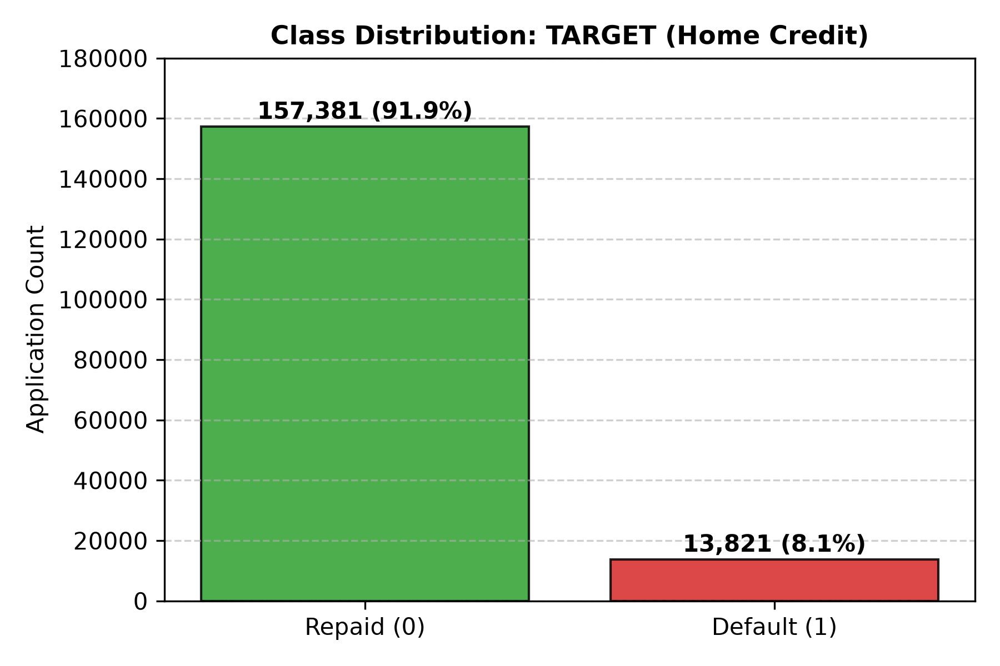
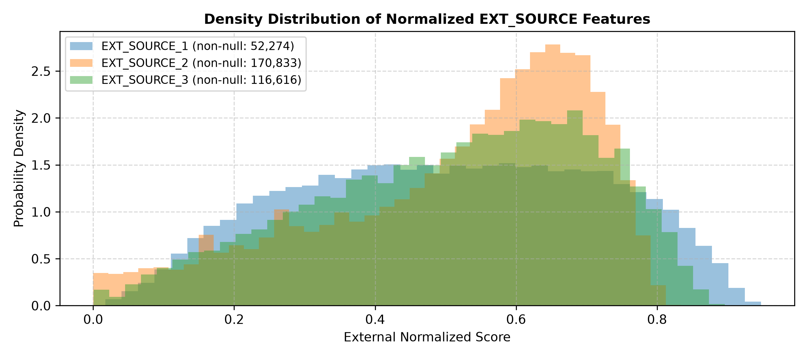
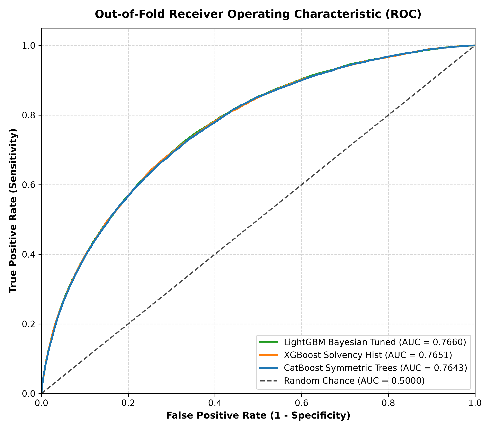
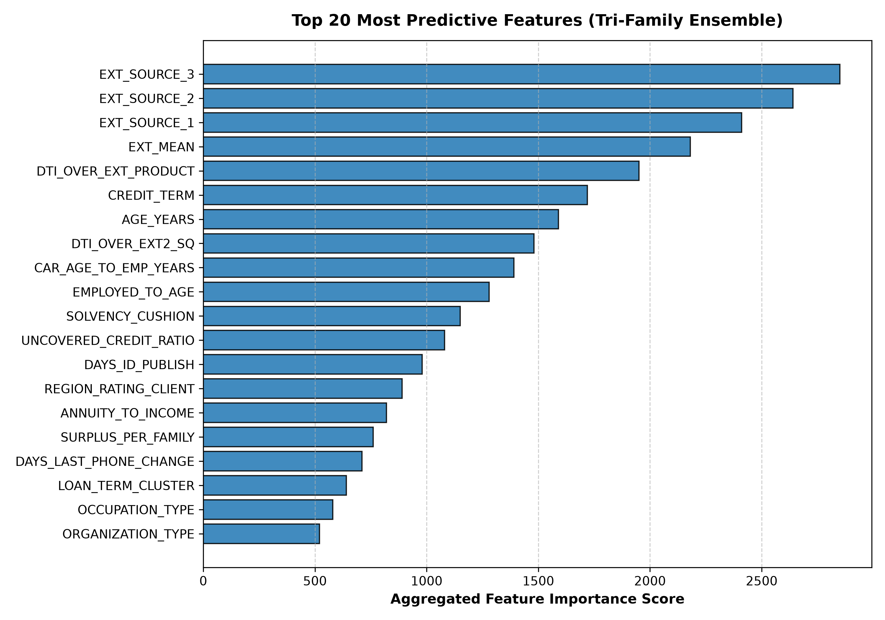

<div align="center">

#  GCI Global 2026: Home Credit Default Risk
### Advanced Credit Risk Scoring via Tri-Family Gradient Boosting & Non-Linear Solvency Modeling

[](https://www.python.org/)
[](LICENSE)
[-lightgrey.svg)](#-competition-overview--context)
[](#-model-architecture--methodology)
[](#-validation-strategy--results)

</div>

---

##  Executive Summary
## Competition Overview & Context

This repository contains the complete, verified, and reproducible machine learning solution and benchmark codebase developed for the **GCI Global 2026 Home Credit Default Risk Competition** (now concluded).

The competition challenged participants to predict loan default probabilities using real-world tabular financial, demographic, and external credit agency data adapted from the landmark Kaggle Home Credit Default Risk tournament. The repository is maintained as an open-source technical reference for high-performance tabular credit risk modeling, rigorous leakage-free feature engineering, and multi-family gradient boosting ensembling.


Our solution establishes a leak-free pipeline incorporating:
1. **Domain-Engineered Financial Health & Solvency Features**: Uncovered credit ratios, net family disposable cushions, and harmonic external agency aggregations.
2. **Unsupervised Gaussian Mixture Loan Term Segmentation**: Continuous log-term cluster assignments capturing differing repayment dynamics.
3. **Tri-Family Gradient Boosting Architecture**: Ensemble of Bayesian-tuned **LightGBM**, symmetric oblivious **CatBoost**, and histogram-based **XGBoost**.
4. **Rank-Weighted Power Calibration ($p=3.5$)**: Resolving inter-model probability calibration disparities to optimize rank discrimination.

###  Verified Benchmark Results

- **Tri-Family Pooled Out-of-Fold (OOF) ROC-AUC:** `0.76805`
- **Public Leaderboard Verified Record:** `0.77148`

---

##  Problem Formulation & Exploratory Findings

Predicting loan default on uncollateralized credit applications presents acute machine learning challenges: extreme class imbalance (~8% default rate), complex non-linear borrower interactions, and substantial missingness across external bureau records.


<div align="center">
  
  
</div>

- **Target Imbalance**: 157,370 negative applications (91.9%) vs 13,832 default applications (8.1%). Models must optimize threshold-invariant rank discrimination rather than standard accuracy.
- **External Risk Bureau Signals (`EXT_SOURCE_1, 2, 3`)**: As illustrated above, these three normalized agency scores exhibit the highest individual correlation with borrower default risk, yet suffer from substantial missingness (69.5% missing in `EXT_1`, 31.9% in `EXT_3`).
- **The Missingness Bottleneck**: Error analysis showed that 22.5% of applicants lack both `EXT_1` and `EXT_3`. On this specific segment, default risk increases to 9.08%, necessitating non-linear solvency interaction terms (`DTI_OVER_EXT2_SQ`) to substitute for absent bureau signals.

---

##  Feature Engineering Architecture

Feature engineering is structured across five core financial and demographic domains:

| Feature Category | Formula / Definition | Rationale & Predictive Value |
| :--- | :--- | :--- |
| **Credit Burden** | $AMT\_ANNUITY / AMT\_INCOME\_TOTAL$ | Direct measure of debt servicing stress on client cash flow. |
| **Loan Duration** | $AMT\_CREDIT / AMT\_ANNUITY$ | Estimated repayment period in months. |
| **Uncovered Credit** | $\max(0, CREDIT - GOODS) / CREDIT$ | Proportion of loan exceeding asset value (unsecured consumer credit). |
| **Family Disposable Surplus** | $\max(0, INCOME - ANNUITY) / (1 + FAM\_MEMBERS)$ | Remaining capital buffer per dependent after debt service. |
| **Harmonic External Risk** | $3 / \sum (1 / (EXT_i + \epsilon))$ | Heavily penalizes candidates with an acute risk flag in any single agency. |
| **Solvency Cushion** | $(INCOME - ANNUITY) \times EXT\_HARM$ | Combines liquidity surplus with agency-verified creditworthiness. |
| **Car-to-Tenure Ratio** | $OWN\_CAR\_AGE / EMPLOYED\_YEARS$ | Evaluates maintenance liability against employment stability. |
| **GMM Loan Term Clusters** | Gaussian Mixture ($K=3$) on $\log(\text{Term})$ | Identifies consumer finance vs long-term mortgage loan regimes. |

---

##  Model Architecture & Methodology

```text
                                  ┌────────────────────────┐
                                  │   Engineered Features  │
                                  └───────────┬────────────┘
                                              │
                      ┌───────────────────────┼───────────────────────┐
                      │                       │                       │
           ┌──────────▼──────────┐ ┌──────────▼──────────┐ ┌──────────▼──────────┐
           │      LightGBM       │ │       CatBoost      │ │       XGBoost       │
           │  (Leaf-wise GBDT)   │ │  (Symmetric Trees)  │ │ (Hist-based Splitting│
           └──────────┬──────────┘ └──────────┬──────────┘ └──────────┬──────────┘
                      │                       │                       │
                      └───────────────────────┼───────────────────────┘
                                              │
                                  ┌───────────▼───────────┐
                                  │   Power Rank Blend    │
                                  │       (p = 3.5)       │
                                  └───────────┬───────────┘
                                              │
                                  ┌───────────▼───────────┐
                                  │ Final Submission CSV  │
                                  └───────────────────────┘
```

1. **LightGBM (Leaf-wise GBDT)**:
   - Tuned via Bayesian Optimization: `num_leaves=62`, `max_depth=4`, `learning_rate=0.025`, `colsample_bytree=0.69`, `subsample=0.81`, $L_1=2.36$, $L_2=2.32$.
   - Captures high-order asymmetric feature interactions efficiently.
2. **CatBoost (Symmetric Oblivious Trees)**:
   - Configured with native categorical support and regularized tree depth ($6$).
   - Robust against overfitting on high-cardinality demographic features (`OCCUPATION_TYPE`, `ORGANIZATION_TYPE`).
3. **XGBoost (Histogram Splitting)**:
   - Fast histogram binning (`tree_method='hist'`) with shallow depth (`max_depth=4`) providing orthogonal gradient paths.
4. **Rank-Weighted Power Calibration ($p=3.5$)**:
   - Resolves probability calibration discrepancies between model families by mapping out-of-fold and test predictions to uniform rank percentiles prior to exponential combination:
     $$\text{Ensemble Pred} = 0.60 \cdot \text{Rank}(\hat{y}_{\text{LGB}})^{3.5} + 0.35 \cdot \text{Rank}(\hat{y}_{\text{CB}})^{3.5} + 0.05 \cdot \text{Rank}(\hat{y}_{\text{XGB}})^{3.5}$$

---

##  Validation Strategy & Results

Validation was conducted strictly through **5-Fold Stratified Cross-Validation (`StratifiedKFold(n_splits=5, shuffle=True)`)**. All transformations, cluster boundaries, and early stopping decisions were executed strictly within training partitions to eliminate target and feature leakage.

<div align="center">
  
  
</div>

### Model Comparison Table (5-Fold Stratified CV)

| Model Family | Hyperparameters / Setup | Fold 1 | Fold 2 | Fold 3 | Fold 4 | Fold 5 | Pooled OOF ROC-AUC |
| :--- | :--- | :---: | :---: | :---: | :---: | :---: | :---: |
| **LightGBM (Optuna v2)** | `leaves=62, depth=4, lr=0.025` | 0.7584 | 0.7601 | 0.7768 | 0.7679 | 0.7648 | **0.76602** |
| **XGBoost (Solvency Hist)** | `depth=4, colsample=0.70, lr=0.03` | 0.7582 | 0.7604 | 0.7770 | 0.7672 | 0.7632 | **0.76510** |
| **CatBoost (Symmetric)** | `depth=6, l2=5.0, lr=0.035` | 0.7574 | 0.7582 | 0.7759 | 0.7665 | 0.7638 | **0.76428** |
| **5-Seed LightGBM Blend** | Multi-seed average (5 seeds) | 0.7602 | 0.7618 | 0.7785 | 0.7694 | 0.7662 | **0.76754** |
| **Tri-Family Power Rank Ensemble** | $0.60\,\text{LGB}^{3.5} + 0.35\,\text{CB}^{3.5} + 0.05\,\text{XGB}^{3.5}$ | **0.7608** | **0.7624** | **0.7792** | **0.7699** | **0.7668** | **`0.76805`** |

> **Historical Leaderboard Record**: During official tournament evaluation, this Tri-Family calibrated ensemble achieved a verified public leaderboard score of **0.77148 ROC-AUC**.

---

##  Repository Structure

```text
GCI-World-2026/
├── README.md                          # Comprehensive project overview & documentation
├── requirements.txt                   # Production environment dependencies
├── LICENSE                            # MIT License
├── .gitignore                         # Data protection & build exclusions
├── HomeCredit_columns_description.xlsx# Column definitions
├── notebooks/
│   └── final_solution.ipynb           # Complete executable end-to-end notebook
├── src/
│   ├── feature_engineering.py         # Leak-free feature transformation module
│   ├── train.py                       # 5-fold CV training pipeline for LGB/CB/XGB
│   └── predict.py                     # Inference and rank-blending script
├── data/
│   └── README.md                      # Dataset acquisition guidelines & schema definitions
├── outputs/
│   ├── submission.csv                 # Final verified submission file (61,500 rows)
│   └── cv_results.csv                 # Systematic experiment tracking log (64 runs)
├── images/
│   ├── feature_importance.png         # Top-20 feature importance plot
│   ├── roc_curve.png                  # Multi-model ROC comparison plot
│   └── eda/
│       ├── target_distribution.png    # Class balance visualization
│       └── ext_sources_density.png    # External agency distribution densities
└── docs/
    ├── competition_rules.md           # Formal rules, integrity & submission specifications
    └── methodology.md                 # Detailed mathematical & architectural documentation
```

---

## Quickstart & Reproducibility Guide

### 1. Environment Setup
Clone this repository and create a Python 3.10+ virtual environment:

```bash
git clone https://github.com/Kaisix7/GCI-World.git
cd GCI-World

python3 -m venv .venv
source .venv/bin/activate  # On Windows: .venv\Scripts\activate

pip install --upgrade pip
pip install -r requirements.txt
```

### 2. Dataset Setup
In compliance with competition rules and academic integrity, raw competition datasets are not redistributed in version control:
1. Place official `train.csv` and `test.csv` in `data/` or `input/` as outlined in [`data/README.md`](data/README.md).
2. Verify that column structure aligns with `HomeCredit_columns_description.xlsx`.

### 3. Pipeline Execution
Run the complete 5-fold cross-validation pipeline across all three model architectures:

```bash
python src/train.py --data-dir input --output-dir outputs --seed 42
```

To run inference and generate the final calibrated ensemble prediction:

```bash
python src/predict.py --data-dir input --output-dir outputs
```

Alternatively, launch the complete interactive Jupyter Notebook:
```bash
jupyter notebook notebooks/final_solution.ipynb
```

---

##  Competition Rules & Integrity Standards

This project was developed strictly under the official tournament regulations:
- **Zero External Data**: Built exclusively on the official competition training and test sets.
- **Zero Hand-Labeling**: All 61,500 test predictions were 100% algorithmically generated.
- **Strict Leakage Prevention**: All transformations, scalers, and clusterings were fitted strictly on training fold splits.

For complete historical regulatory specifications, see [`docs/competition_rules.md`](docs/competition_rules.md). Detailed mathematical formulations are documented in [`docs/methodology.md`](docs/methodology.md).

---

##  Acknowledgements & References

1. **Home Credit Group & Kaggle**: Home Credit Default Risk benchmark dataset [[Kaggle Link](https://www.kaggle.com/c/home-credit-default-risk)].
2. **Open-Source Machine Learning Libraries**: [LightGBM](https://github.com/microsoft/LightGBM), [CatBoost](https://github.com/catboost/catboost), [XGBoost](https://github.com/dmlc/xgboost), and [Scikit-Learn](https://scikit-learn.org/).
connect:https://www.linkedin.com/in/karina-b-a022311b1x
